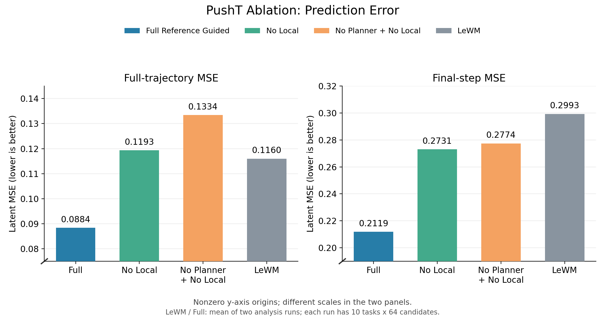
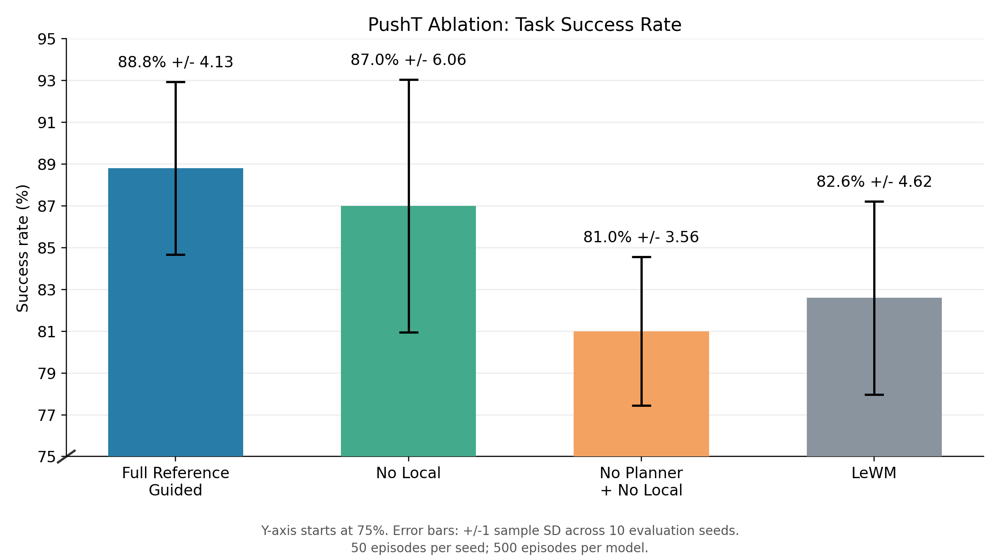

# PushT Ablation 结果

| 模型 | 全程 MSE ↓ | 终点 MSE ↓ | 正确率（均值 ± 标准差） | 全程 MSE 降低 | 终点 MSE 降低 | 正确率提升 |
|---|---|---|---|---|---|---|
| Full Reference Guided | 0.08840 | 0.21192 | 88.80 ± 4.13% | +23.79% | +29.20% | +6.20 个百分点 |
| No Local | 0.11933 | 0.27312 | 87.00 ± 6.06% | -2.87% | +8.76% | +4.40 个百分点 |
| No Planner + No Local | 0.13344 | 0.27744 | 81.00 ± 3.56% | -15.03% | +7.31% | -1.60 个百分点 |
| LeWM | 0.11600 | 0.29933 | 82.60 ± 4.62% | +0.00% | +0.00% | +0.00 个百分点 |

优化量以 LeWM 为基线，正数表示改善。MSE 降低 = (LeWM MSE − 模型 MSE) / LeWM MSE。

LeWM 与完整版 MSE 取两次离线分析的均值，两组消融各使用自身结果；每次分析为 10 个任务 × 64 条候选。正确率为 10 个种子 × 50 次任务；± 为评估种子间样本标准差，不是置信区间或训练种子间波动。

